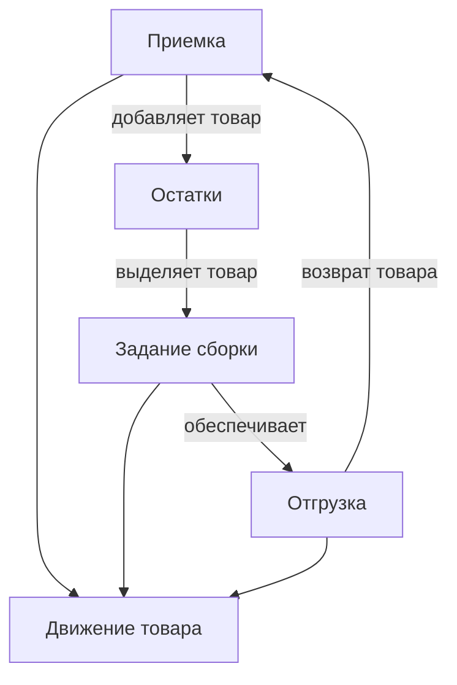

# Концептуальная модель

Склад хранит товары разных продавцов. Приемка увеличивает остаток, задание
сборки перемещает товар в упаковку, а отгрузка списывает его со склада.
Остаток показывает, сколько товара находится на складе сейчас, движение -
как это количество изменилось. В документах и движениях хранится сотрудник,
выполнивший операцию.

В модели есть следующие сущности:

- Продавец.
- Категория товара.
- Товар.
- Сотрудник.
- Сортировочный центр.
- Адрес хранения.
- Приемка и позиция приемки.
- Остаток и движение товара.
- Инвентаризация и позиция инвентаризации.
- Отгрузка и позиция отгрузки.
- Задание сборки.
- Запись аудита.

## Основные процессы

Адреса хранения и категории товаров образуют иерархии. Один товар может
храниться в нескольких ячейках, но в каждой ячейке находится только один товар.
Позиции приемки и отгрузки связывают документы с товарами и количеством.

Сортировочные центры выступают получателями отгрузок и источниками возвратов.
Аудит хранит снимки строк до и после изменения. Инвентаризации хранят учетное
и фактически пересчитанное количество; проведение инвентаризации пока не реализовано.
