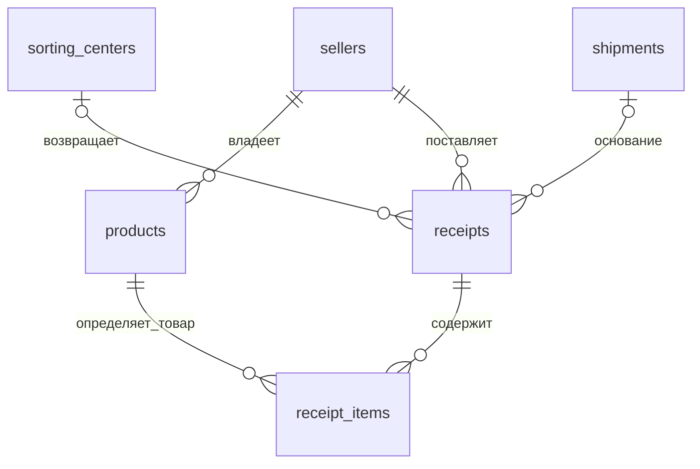
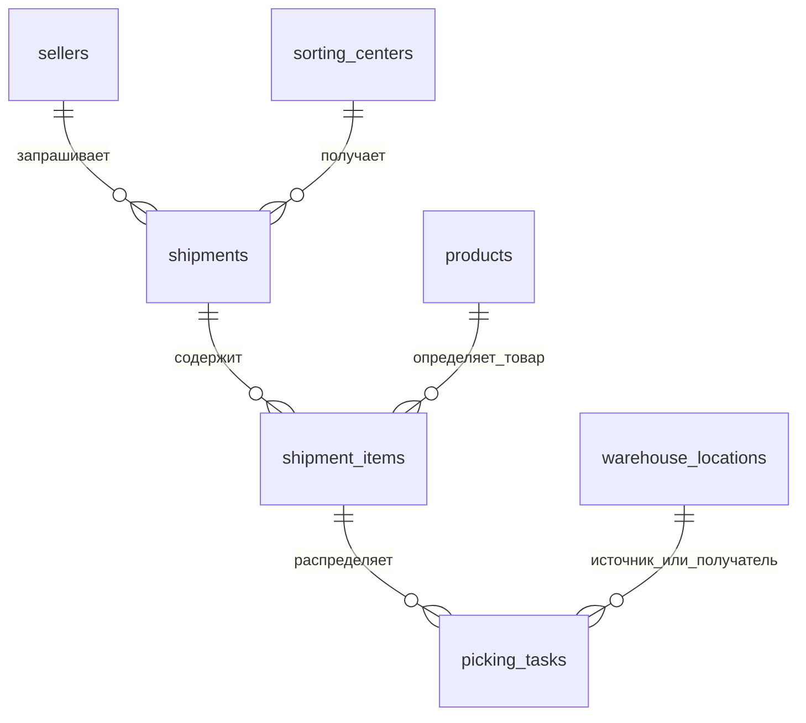
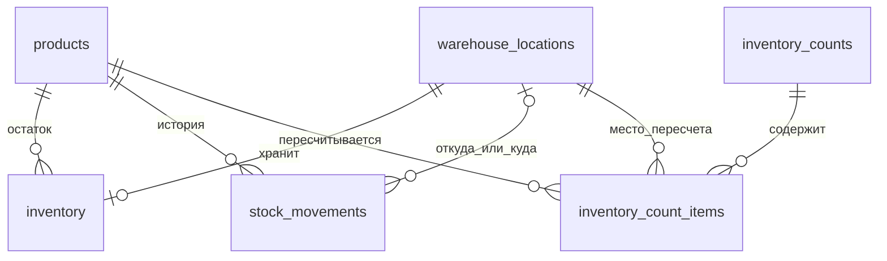

# Логическая модель

В большинстве таблиц первичный ключ - BIGINT с автоматическим присвоением ID.
У inventory составной ключ (product_id, location_id) и ограничение
UNIQUE(location_id): товар может занимать несколько ячеек,
но каждая ячейка содержит только один товар.

## Внешние ключи

Все связи используют ON UPDATE RESTRICT и ON DELETE RESTRICT.
Необязательный родитель означает, что значение внешнего ключа может быть NULL.
У родителя может не быть дочерних записей. Полнота документа проверяется
при переходе к следующему этапу обработки.

| Ключ родителя | Ключ дочерней таблицы | Тип связи | Родитель необязателен |
|---|---|---|---|
| product_categories.category_id | product_categories.parent_category_id | 1:N | да |
| sellers.seller_id | products.seller_id | 1:N | нет |
| product_categories.category_id | products.category_id | 1:N | нет |
| warehouse_locations.location_id | warehouse_locations.parent_location_id | 1:N | да |
| sellers.seller_id | shipments.seller_id | 1:N | нет |
| sorting_centers.sorting_center_id | shipments.sorting_center_id | 1:N | нет |
| employees.employee_id | shipments.created_by_employee_id | 1:N | нет |
| shipments.shipment_id | shipment_items.shipment_id | 1:N | нет |
| products.product_id | shipment_items.product_id | 1:N | нет |
| sellers.seller_id | receipts.seller_id | 1:N | нет |
| sorting_centers.sorting_center_id | receipts.sorting_center_id | 1:N | да |
| shipments.shipment_id | receipts.source_shipment_id | 1:N | да |
| employees.employee_id | receipts.created_by_employee_id | 1:N | нет |
| employees.employee_id | receipts.processed_by_employee_id | 1:N | да |
| receipts.receipt_id | receipt_items.receipt_id | 1:N | нет |
| products.product_id | receipt_items.product_id | 1:N | нет |
| employees.employee_id | inventory_counts.created_by_employee_id | 1:N | нет |
| employees.employee_id | inventory_counts.performed_by_employee_id | 1:N | да |
| inventory_counts.inventory_count_id | inventory_count_items.inventory_count_id | 1:N | нет |
| products.product_id | inventory_count_items.product_id | 1:N | нет |
| warehouse_locations.location_id | inventory_count_items.location_id | 1:N | нет |
| shipment_items.shipment_item_id | picking_tasks.shipment_item_id | 1:N | нет |
| warehouse_locations.location_id | picking_tasks.source_location_id | 1:N | нет |
| warehouse_locations.location_id | picking_tasks.target_location_id | 1:N | нет |
| employees.employee_id | picking_tasks.assigned_employee_id | 1:N | да |
| products.product_id | inventory.product_id | 1:N | нет |
| warehouse_locations.location_id | inventory.location_id | 1:0..1 | нет |
| products.product_id | stock_movements.product_id | 1:N | нет |
| warehouse_locations.location_id | stock_movements.from_location_id | 1:N | да |
| warehouse_locations.location_id | stock_movements.to_location_id | 1:N | да |
| employees.employee_id | stock_movements.performed_by_employee_id | 1:N | нет |
| receipt_items.receipt_item_id | stock_movements.receipt_item_id | 1:N | да |
| shipment_items.shipment_item_id | stock_movements.shipment_item_id | 1:N | да |
| picking_tasks.picking_task_id | stock_movements.picking_task_id | 1:N | да |
| inventory_count_items.inventory_count_item_id | stock_movements.inventory_count_item_id | 1:N | да |
| employees.employee_id | audit_logs.employee_id | 1:N | да |

## Документы приемки

## Документы отгрузки

## Остатки и инвентаризации

На схемах сгруппированы основные связи. Таблица выше также содержит ссылки
на сотрудников, обе роли адресов хранения и документы-основания движений.
Имена сущностей совпадают с именами таблиц в SQL.

## Бизнес-ключи и хранение истории

Артикулы и номера документов уникальны во всей базе. Коды продавцов,
сотрудников, центров и адресов хранения также уникальны. Названия категорий
уникальны внутри одного родителя, включая корневые категории благодаря
UNIQUE NULLS NOT DISTINCT. Позиции приемки и отгрузки уникальны по сочетанию
документа и товара, задания сборки - позиции и двух ячеек,
позиции инвентаризации - документа пересчета и адреса хранения.

Справочники используют мягкое удаление. Завершенные приемки, отгрузки
и задания сборки менять нельзя. Журнал движений и аудит запрещают UPDATE/DELETE.
У документов инвентаризации пока нет проверок переходов статусов.
Ключи аудита хранятся в JSONB, чтобы поддерживать как простой ID,
так и составной ключ остатков.
