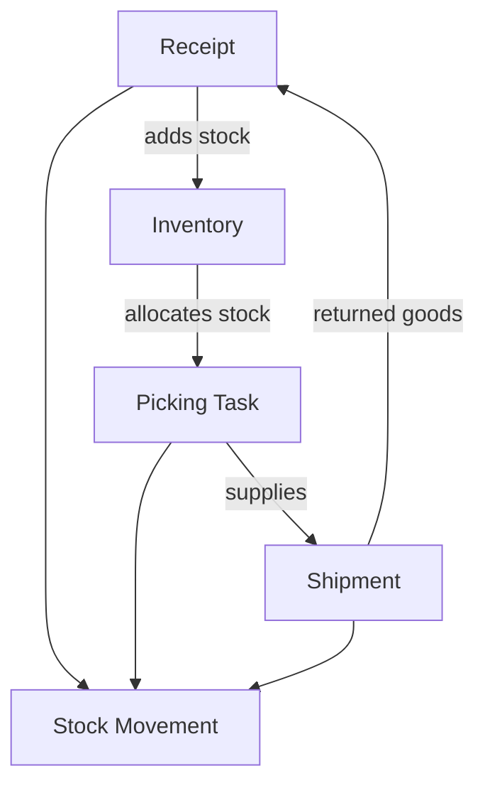

# Conceptual model

The warehouse stores products owned by sellers. A receipt adds stock, a picking
task moves it to packing, and a shipment removes it from the warehouse.
The balance describes what is present now; a movement describes one change.
Documents and movements retain the employee who performed the operation.

The model contains these entities:

- Seller
- Product Category
- Product
- Employee
- Sorting Center
- Warehouse Location
- Receipt and Receipt Item
- Inventory and Stock Movement
- Inventory Count and Inventory Count Item
- Shipment and Shipment Item
- Picking Task
- Audit Log

## Main business flows

Warehouse locations and product categories are hierarchical. A product can be
stored in multiple cells, while each cell can contain at most one product.
Receipt and shipment items connect documents to products and quantities.
Sorting centers are shipment destinations and return sources. Audit entries
store row snapshots; inventory counts store expected and counted quantities.
Count posting is not implemented yet.
