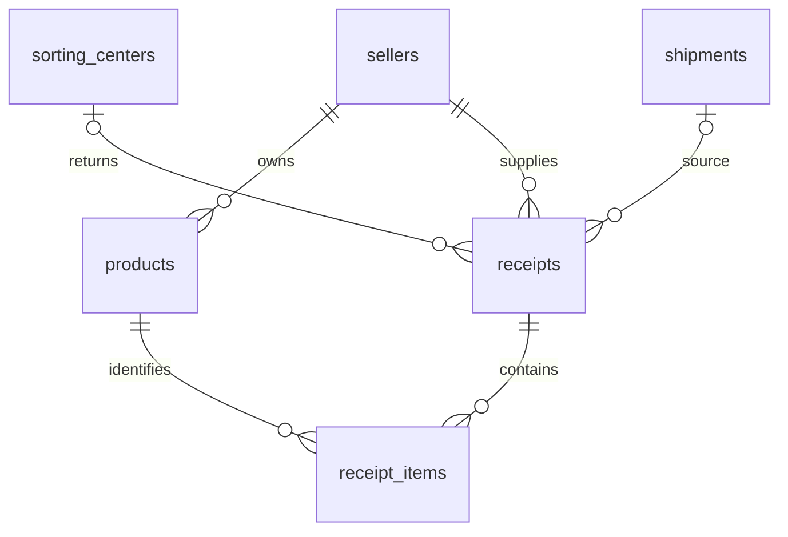
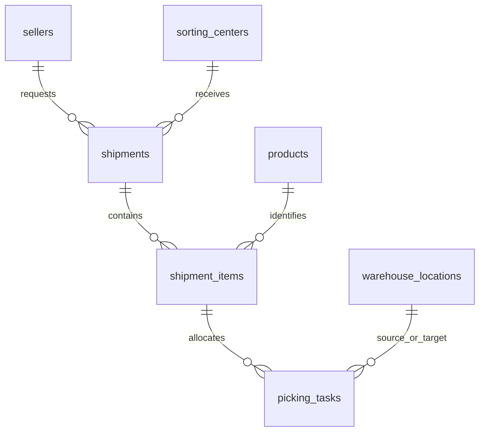
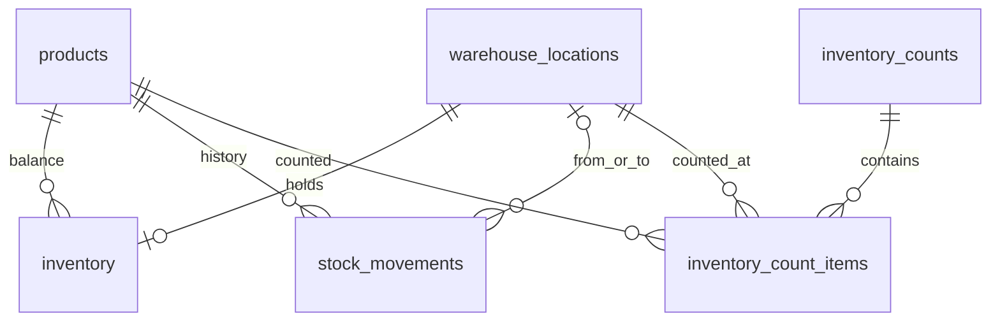

# Logical model

Most tables have a BIGINT identity primary key. Inventory uses the composite
primary key (product_id, location_id), plus UNIQUE(location_id): a product may
occupy several cells, but each cell holds only one product.

## Foreign keys

All references use ON UPDATE RESTRICT and ON DELETE RESTRICT. Optional means
the child FK may be NULL. Parents can have zero children; document completeness
is checked when a workflow advances.

| Parent key | Child key | Parent to child | Optional parent |
|---|---|---|---|
| product_categories.category_id | product_categories.parent_category_id | 1:N | yes |
| sellers.seller_id | products.seller_id | 1:N | no |
| product_categories.category_id | products.category_id | 1:N | no |
| warehouse_locations.location_id | warehouse_locations.parent_location_id | 1:N | yes |
| sellers.seller_id | shipments.seller_id | 1:N | no |
| sorting_centers.sorting_center_id | shipments.sorting_center_id | 1:N | no |
| employees.employee_id | shipments.created_by_employee_id | 1:N | no |
| shipments.shipment_id | shipment_items.shipment_id | 1:N | no |
| products.product_id | shipment_items.product_id | 1:N | no |
| sellers.seller_id | receipts.seller_id | 1:N | no |
| sorting_centers.sorting_center_id | receipts.sorting_center_id | 1:N | yes |
| shipments.shipment_id | receipts.source_shipment_id | 1:N | yes |
| employees.employee_id | receipts.created_by_employee_id | 1:N | no |
| employees.employee_id | receipts.processed_by_employee_id | 1:N | yes |
| receipts.receipt_id | receipt_items.receipt_id | 1:N | no |
| products.product_id | receipt_items.product_id | 1:N | no |
| employees.employee_id | inventory_counts.created_by_employee_id | 1:N | no |
| employees.employee_id | inventory_counts.performed_by_employee_id | 1:N | yes |
| inventory_counts.inventory_count_id | inventory_count_items.inventory_count_id | 1:N | no |
| products.product_id | inventory_count_items.product_id | 1:N | no |
| warehouse_locations.location_id | inventory_count_items.location_id | 1:N | no |
| shipment_items.shipment_item_id | picking_tasks.shipment_item_id | 1:N | no |
| warehouse_locations.location_id | picking_tasks.source_location_id | 1:N | no |
| warehouse_locations.location_id | picking_tasks.target_location_id | 1:N | no |
| employees.employee_id | picking_tasks.assigned_employee_id | 1:N | yes |
| products.product_id | inventory.product_id | 1:N | no |
| warehouse_locations.location_id | inventory.location_id | 1:0..1 | no |
| products.product_id | stock_movements.product_id | 1:N | no |
| warehouse_locations.location_id | stock_movements.from_location_id | 1:N | yes |
| warehouse_locations.location_id | stock_movements.to_location_id | 1:N | yes |
| employees.employee_id | stock_movements.performed_by_employee_id | 1:N | no |
| receipt_items.receipt_item_id | stock_movements.receipt_item_id | 1:N | yes |
| shipment_items.shipment_item_id | stock_movements.shipment_item_id | 1:N | yes |
| picking_tasks.picking_task_id | stock_movements.picking_task_id | 1:N | yes |
| inventory_count_items.inventory_count_item_id | stock_movements.inventory_count_item_id | 1:N | yes |
| employees.employee_id | audit_logs.employee_id | 1:N | yes |

## Receipt documents

## Outbound documents

## Balances and counts

The diagrams group the main links. The table includes employee references,
both location roles and movement links to business documents.

## Business keys and history

SKUs and document numbers are globally unique. Seller, employee, center and
location codes are also unique. Category names are unique within one parent,
including root categories through UNIQUE NULLS NOT DISTINCT.
Receipt/shipment lines are unique by document/product, picking tasks by
line/source/target, and count lines by count/location.

Reference entities use soft deletion. Completed receipts, shipments and picking
tasks reject edits; journal and audit rows reject UPDATE/DELETE. Count documents
currently have no workflow guards. Audit keys use JSONB to support both simple
identity keys and the composite inventory key.
